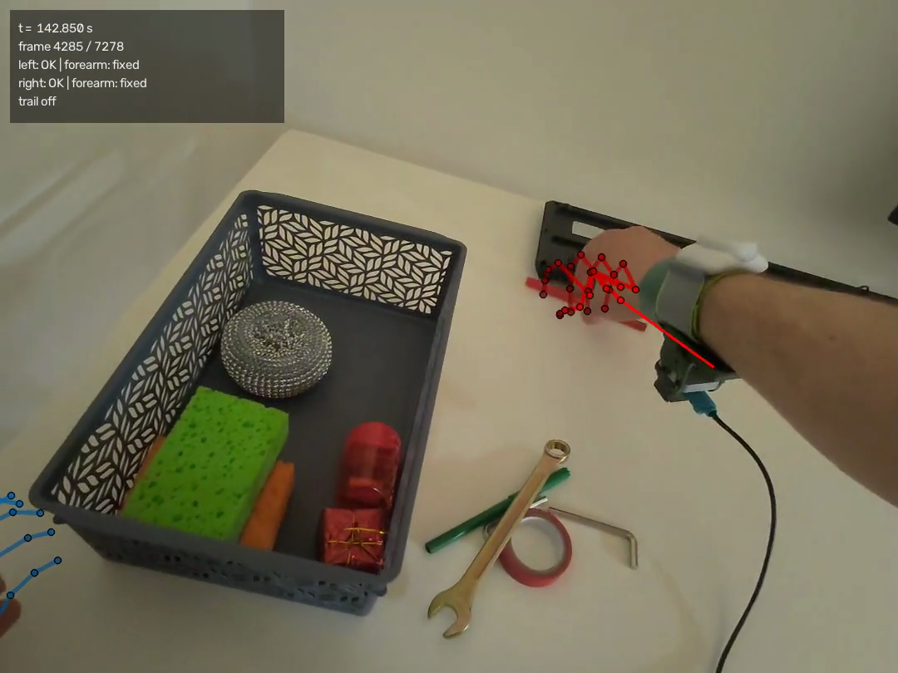

# Визуализация данных движения VR-устройства (PICO 4 Ultra)

Наложение трекинга рук и головы на видеозапись с камеры шлема (OpenCV) и интерактивные графики
траекторий (Plotly) — один законченный подход к тестовому заданию XRoboToolkit.

Репозиторий: **[github.com/Stamwok/vr-tracking-viz](https://github.com/Stamwok/vr-tracking-viz)** ·
лицензия [MIT](LICENSE).

## Пример результата



*Кадр 4285 (`t = 142.85 с`) из `output/overlay.mp4`: все 26 суставов OpenXR на каждую руку, цвет и
прозрачность костей кодируют глубину относительно ближайшего сустава своей руки, тонкая линия из
кисти — 10-см указатель на локоть, HUD — время, номер кадра и состояние рук.*

- [`docs/preview.gif`](docs/preview.gif) — три секунды наложения в движении (кадры 4300–4390).
- [`docs/media/overlay_10s.mp4`](docs/media/overlay_10s.mp4) — 10-секундный фрагмент (кадры 1750–2050).
- [`docs/preview_trajectory.png`](docs/preview_trajectory.png) — скриншот интерактивных графиков из
  `output/trajectory.html` (сам файл открывается двойным щелчком, без сервера).
- Полный клип `output/overlay.mp4` (1080×810, все 26 суставов, HUD) собирается одной командой —
  см. «Установка и запуск»; в репозиторий он не коммитится.

## Установка и запуск

`output/trajectory.html` открывается двойным щелчком — без сервера.

```bash
git clone https://github.com/Stamwok/vr-tracking-viz.git
cd vr-tracking-viz

python3 -m venv .venv && source .venv/bin/activate   # Python 3.12+ (numpy 2.5 / pandas 3.1)
pip install -r requirements.txt

# входные файлы — в data/ (в репозитории их нет; git не хранит пустые каталоги)
mkdir -p data
# data/CameraRecord_20260505_165740.mp4
# data/trackingData_20260505_165740.txt

# метаданные видео (video_meta.json) — их читают рендер и тесты, выходного CSV они не касаются
python src/video_meta.py data/CameraRecord_20260505_165740.mp4

python src/parse_tracking.py data/trackingData_20260505_165740.txt -o output/tracking.csv
python src/overlay_video.py data/CameraRecord_20260505_165740.mp4 \
                            --tracking data/trackingData_20260505_165740.txt \
                            --out output/overlay.mp4
python src/plot_trajectory.py --tracking output/tracking.csv -o output/trajectory.html
python src/sync_viewer.py --tracking output/tracking.csv -o output/sync_viewer.html

# sync_viewer.html открывается только через сервер (file:// блокирует <video>):
python -m http.server -d output 8000     # → http://localhost:8000/sync_viewer.html

# тесты (688, ≈1.5 мин; часть помечена skip, если нет data/ или output/video_meta.json):
python -m unittest discover -s tests -t .
```

## Подход, наблюдения, сложности

Парсим файл трекинга (JSON Lines, 21 787 сэмплов ~90 Гц: голова и 26 джойнтов OpenXR на каждую
руку) в `output/tracking.csv`; числа записаны с десятичной запятой, совпадающей с разделителем
полей, поэтому пары токенов склеиваются и проверяются по норме кватерниона. Кадр `k` получает
время `header.timeStampNs + k·33.34 мс`, поза интерполируется (позиция линейно, кватернион через
SLERP) и проецируется камерой-обскурой с per-eye интринсиками из записи; поза камеры — поза головы
плюс откалиброванная константа `T_head_cam`. На 5 размеченных кадрах все 40 суставов, попавших в
кадр, лежат в рамках своих рук (40/40, средняя ошибка 0 px), а видео отстаёт от меток примерно на
100 мс — эмпирическая поправка `VIDEO_TIME_OFFSET_MS = −100 мс` уменьшает слёт скелета на быстрых
кадрах с ~73 до ~35 px (по ладони и запястью — 2–4 px). Точность наложения всё равно ограничена
кистью: фаланги сжатых пальцев уезжают до 170 px, поэтому приблизительность честно ограничена
ладонью и запястьем.

Подробности — [`docs/OBSERVATIONS.md`](docs/OBSERVATIONS.md): наблюдения по данным, сложности
«проблема → как решено» и допущения. Технические заметки — [`docs/intrinsics.md`](docs/intrinsics.md),
[`docs/projection_notes.md`](docs/projection_notes.md), [`docs/overlay.md`](docs/overlay.md); журнал
задач — [`docs/NOTES.md`](docs/NOTES.md).

## Структура

```
VRTrackingTestTask/
├── data/          # mp4 + txt (не коммитятся)
├── src/           # парсинг, синхронизация, камера, калибровка, рендер, графики
├── tests/         # unittest: парсер, синхронизация, камера, рендер, графики
├── docs/          # OBSERVATIONS, NOTES, intrinsics, projection_notes, overlay,
│                  # preview.png/gif, preview_trajectory.png, media/, images/
├── output/        # video_meta.json, tracking.csv, overlay.mp4, *.html (не коммитится)
├── requirements.txt
├── LICENSE        # MIT
├── README.md
└── CLAUDE.md
```

## Ссылки

- XRoboToolkit PC-Service (формат данных): https://github.com/XR-Robotics/XRoboToolkit-PC-Service
- XRoboToolkit Unity-Client (рекордер): https://github.com/XR-Robotics/XRoboToolkit-Unity-Client
- XRoboToolkit: A Cross-Platform Framework for Robot Teleoperation — IEEE/SICE SII 2026,
  DOI [10.1109/SII64115.2026.11404528](https://doi.org/10.1109/SII64115.2026.11404528);
  препринт: https://arxiv.org/abs/2508.00097
