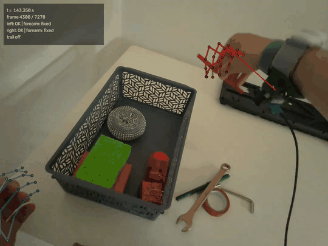
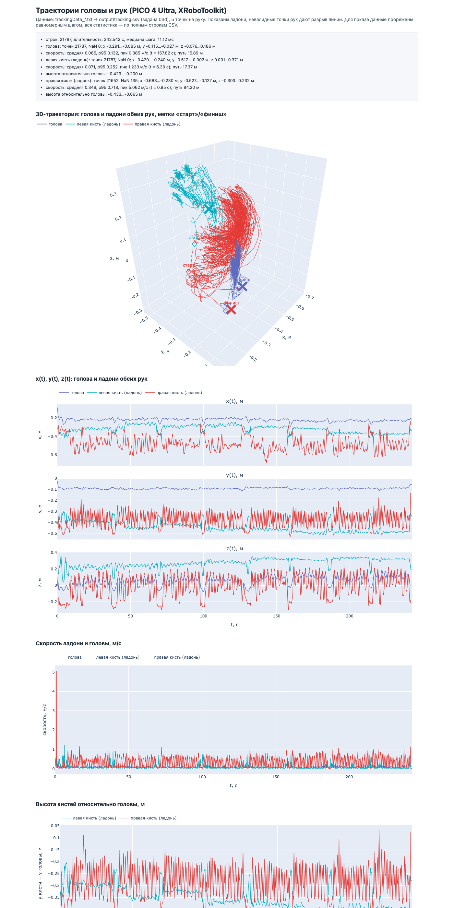

# Визуализация данных движения VR-устройства (PICO 4 Ultra)

Наложение трекинга рук и головы на видеозапись с камеры шлема (OpenCV) и интерактивные графики
траекторий (Plotly) — один законченный подход к тестовому заданию XRoboToolkit.
- [`Full video`](https://www.dropbox.com/scl/fi/4h0lvgcahgz5e4ad4ctqz/overlay.mp4?rlkey=uetmojtgagarmhk0oancobiof&dl=0) — полное видео с наложенными точками трекинга

Репозиторий: **[github.com/Stamwok/vr-tracking-viz](https://github.com/Stamwok/vr-tracking-viz)**

## Пример результата



*Все 26 суставов OpenXR на каждую руку, цвет и
прозрачность костей кодируют глубину относительно ближайшего сустава своей руки, тонкая линия из
кисти — 10-см указатель на локоть, HUD — время, номер кадра и состояние рук.*


Cкриншот интерактивных графиков из
  `output/trajectory.html` (сам файл открывается двойным щелчком, без сервера).
  
- Полный клип `output/overlay.mp4` (1080×810, все 26 суставов, HUD) описано как собрать в «Установка и запуск»; в репозиторий он не коммитится.

## Установка и запуск

```bash
git clone https://github.com/Stamwok/vr-tracking-viz.git
cd vr-tracking-viz

python3 -m venv .venv && source .venv/bin/activate   # Python 3.12+ (numpy 2.5 / pandas 3.1)
pip install -r requirements.txt

# входные файлы — в data/ (в репозитории их нет; git не хранит пустые каталоги)
mkdir -p data
# data/CameraRecord_20260505_165740.mp4
# data/trackingData_20260505_165740.txt

# метаданные видео (video_meta.json) — их читают рендер и тесты, выходного CSV они не касаются
python src/video_meta.py data/CameraRecord_20260505_165740.mp4

# рендер полного видео с наложенными точками трекинга
python src/overlay_video.py data/CameraRecord_20260505_165740.mp4 \
                            --tracking data/trackingData_20260505_165740.txt \
                            --out output/overlay.mp4
                            
# генерация csv таблицы с данными о трекинге
python src/parse_tracking.py data/trackingData_20260505_165740.txt -o output/tracking.csv
                            
# график движений
python src/plot_trajectory.py --tracking output/tracking.csv -o output/trajectory.html

# интерактивная визуалицая
python src/sync_viewer.py --tracking output/tracking.csv -o output/sync_viewer.html

# sync_viewer.html открывается только через сервер (file:// блокирует <video>):
python -m http.server -d output 8000     # → http://localhost:8000/sync_viewer.html

# тесты (688, ≈1.5 мин; часть помечена skip, если нет data/ или output/video_meta.json):
python -m unittest discover -s tests -t .
```

## Подход, наблюдения, сложности

1. Проблема десятичной запятой в файле трекинга

В чем была проблема: Я обнаружил, что в файле данных числа записаны с десятичной запятой, которая совпадает с разделителем полей. Наивный метод split(",") давал 14 токенов вместо 7, из-за чего данные превращались в мусор.

Как я решил: Я написал парсер, который склеивает пары токенов (float(t[i] + "." + t[i+1]) с шагом 2). Чтобы гарантировать, что я не ошибся, я добавил проверку качества: норма кватерниона (|q| ≈ 1.0) должна быть равна единице. На всех 21 787 сэмплах отклонение составило не более 1.3e-7, что подтвердило правильность парсинга.

2. Неизвестный порядок интринсиков и ловушка стерео-формата (SBS)

В чем была проблема: В заголовке файла лежали четыре числа без подписей, и я не знал, где из них cx, cy, fx, fy. Кроме того, видео было формата side-by-side (2160×810) — то есть содержало картинку для двух глаз. Главная ловушка: в файле был только один набор интринсиков, и он описывал весь стерео-кадр целиком. Если применить эти интринсики к вырезанной половине кадра, горизонтальный масштаб выходил вдвое больше, а главная точка смещалась на 540 px, из-за чего скелет полностью «уезжал» от рук.

Как я решил: Я вывел порядок математически: первые два числа (1079.5 и 404.5) — это ровно центр полного кадра по half-pixel конвенции (2160/2 − 0.5 и 810/2 − 0.5), значит, это [cx, cy, fx, fy]. Так как для демонстрации и оценки точности 2D-проекции одного глаза достаточно (и это вдвое экономит время рендера и вес файла), я решил рендерить только левый глаз. Я обрезал кадр до 1080×810 и пересчитал per-eye интринсики: cx = 539.5 (вместо 1079.5) и fx = fy = 686.868. Проверка FOV (76.35° × 61.05°) совпала со статьей XRoboToolkit до 0.003°, что подтвердило правильность пересчета.

3. Экстринсики не сходятся с позой головы

В чем была проблема: Я обнаружил, что матрицы 4×4 из файла не согласуются с Head.pose первого сэмпла — расхождение составляло около 36°. Использовать их напрямую было нельзя.

Как я решил: Я использовал экстринсики только как подсказку о базе глаз (64 мм). А позу камеры на кадре я стал считать как Head.pose × T_head_cam, где T_head_cam — это подобранный мной поворот на 180° вокруг оси X и нулевое смещение. Я зафиксировал это в config.py и проверил через calib_search: все 40 из 40 суставов попали в рамки своих рук с ошибкой 0 px.

4. Разная частота видео и трекинга (30 fps vs 90 Гц)

В чем была проблема: Я понял, что видео идет с частотой 30 fps (кадр каждые 33.3 мс), а трекинг — ~90 Гц (сэмпл каждые 11.1 мс). На один кадр приходится около 3 сэмплов. Если брать просто ближайший сэмпл, скелет будет «дрожать» на быстрых движениях. Кроме того, в данных были паузы до 67.4 мс.

Как я решил: Я реализовал в sync.py интерполяцию позы. Позиции (x, y, z) я интерполирую линейно, а поворот головы (кватернион) — через SLERP (сферическую интерполяцию). Это дало плавное и точное наложение. При этом я сделал защиту: если в данных есть «дырка» (NaN), я не протягиваю через нее интерполяцию, а оставляю пустоту.

5. Видео отстает от трекинга (~100 мс)

В чем была проблема: На быстрых движениях скелет уезжал с кисти на десятки пикселей. Я выяснил, что это не ошибка калибровки (на медленных кадрах ошибка была всего 4 px), а временная задержка: видео показывает сцену позже, чем нужно.

Как я решил: Я написал диагностический скрипт (drift_diag.py), который измеряет расстояние от проекций до кожи руки (через HSV-маску). Я подобрал эмпирическую константу VIDEO_TIME_OFFSET_MS = −100 мс. С ней ошибка на 50 самых быстрых кадрах упала с 73 px до 34.6 px, а по ладони и запястью — до 2.4 и 4.1 px.

6. Ограничение точности на пальцах 

В чем была проблема: Я увидел, что ладонь и запястье ложатся идеально, но фаланги сжатых пальцев (кулак, щипок) уезжают от реальной руки на видео на расстояние до 170 px.

Как я решил: Я не стал это скрывать или подгонять. Я написал отдельную костную метрику (calib_bones.py), которая честно показала, что только 10 из 48 отрезков скелета укладываются в допуск ±50 px. Я отразил это в README как осознанное ограничение: точность наложения гарантирована только для ладони и запястья, а пальцы — это предел точности самого трекера.

7. Раскраска глубины не работала на вытянутой руке

В чем была проблема: Когда я добавил раскраску костей по глубине (яркость и прозрачность), я обнаружил, что на предельном выносе руки (когда рука целиком далеко) абсолютная шкала упирается в свой минимум, и рука становится просто темным пятном без градаций.

Как я решил: Я переделал шкалу с абсолютной на относительную. Теперь отсчет идет от ближайшего к камере сустава каждой конкретной руки (z_ref). Я также добавил нелинейную шкалу (γ = 0.7), чтобы ближние кости выделялись сильнее, и рисовал дальние кости раньше ближних, чтобы создать правильное ощущение 3D-перекрытия.

8. Огромный размер файла трекинга

В чем была проблема: Файл весил 258 МБ, и загружать его целиком в память через стандартный парсер было бы слишком тяжело и долго.

Как я решил: Я написал потоковый парсер (iter_samples), который читает файл построчно, и запись CSV порциями по 2000 строк. В результате tracking.csv со всеми 26 джойнтами весит 41.5 МиБ, а рендер читает сырой .txt потоково, не нагружая оперативную память.

Подробности — [`docs/OBSERVATIONS.md`](docs/OBSERVATIONS.md): наблюдения по данным, сложности
«проблема → как решено» и допущения. Технические заметки — [`docs/intrinsics.md`](docs/intrinsics.md),
[`docs/projection_notes.md`](docs/projection_notes.md), [`docs/overlay.md`](docs/overlay.md); журнал
задач — [`docs/NOTES.md`](docs/NOTES.md).

## Структура

```
VRTrackingTestTask/
├── data/          # mp4 + txt (не коммитятся)
├── src/           # парсинг, синхронизация, камера, калибровка, рендер, графики
├── tests/         # unittest: парсер, синхронизация, камера, рендер, графики
├── docs/          # OBSERVATIONS, NOTES, intrinsics, projection_notes, overlay,
│                  # preview.png/gif, preview_trajectory.png, media/, images/
├── output/        # video_meta.json, tracking.csv, overlay.mp4, *.html (не коммитится)
├── requirements.txt
├── README.md
└── CLAUDE.md
```

## Ссылки

- XRoboToolkit PC-Service (формат данных): https://github.com/XR-Robotics/XRoboToolkit-PC-Service
- XRoboToolkit Unity-Client (рекордер): https://github.com/XR-Robotics/XRoboToolkit-Unity-Client
- XRoboToolkit: A Cross-Platform Framework for Robot Teleoperation — IEEE/SICE SII 2026,
  DOI [10.1109/SII64115.2026.11404528](https://doi.org/10.1109/SII64115.2026.11404528);
  препринт: https://arxiv.org/abs/2508.00097
