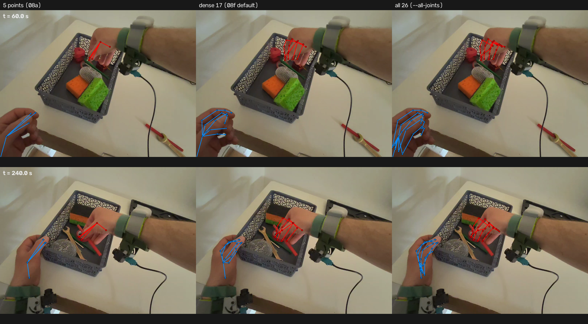
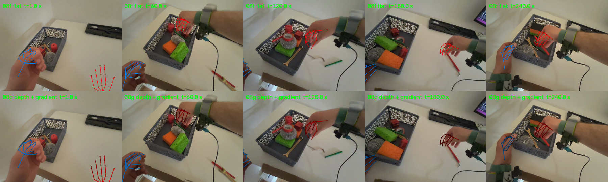
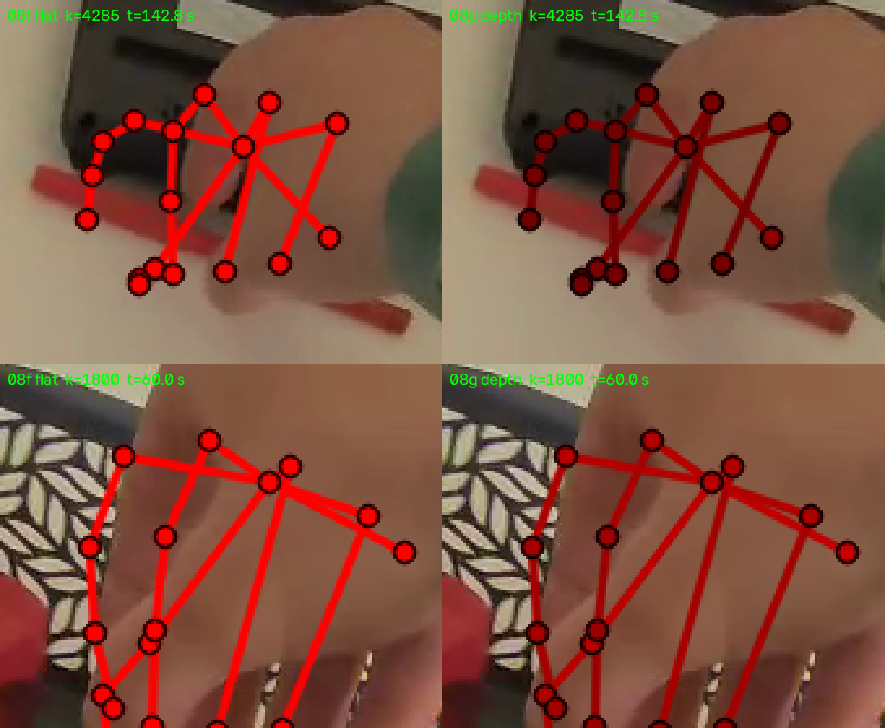
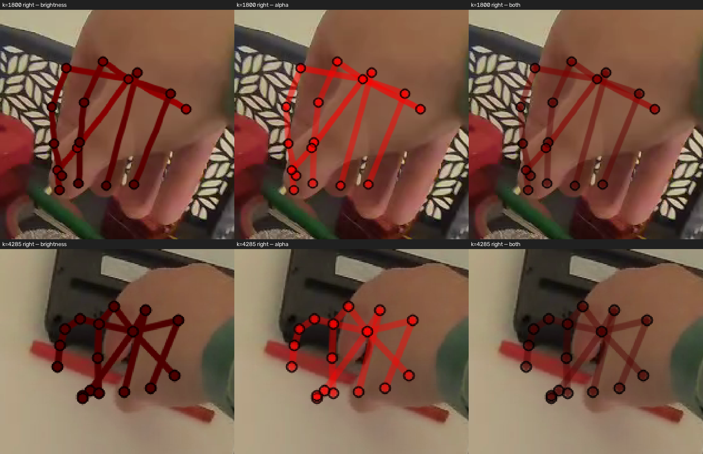
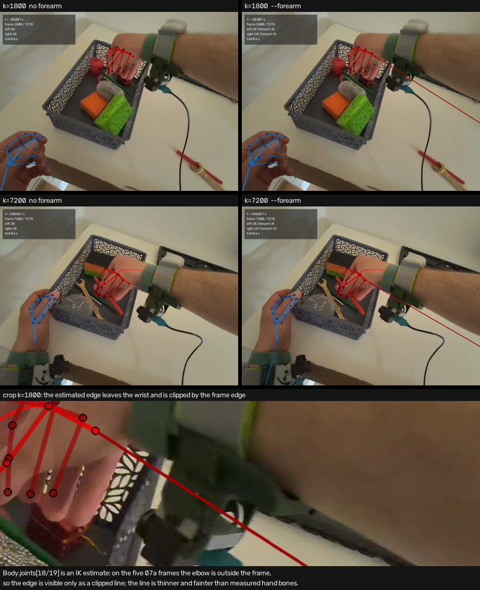

# Наложение: скелет кистей, след, HUD, глубина и предплечье (задачи 08a/08b/08f/08g/08g-fix2/08g-fix3/08g-fix4/08h)












Нижняя сетка — задача 08f: слева прежний 5-точечный скелет (`--five-points`), в центре
густой по умолчанию (17 суставов на руку), справа все 26 джойнтов OpenXR (`--all-joints`).

Слева — кадр 08a (только скелет, `--no-trail --no-hud`), справа — 08b (скелет + след + HUD).
Верхний ряд — t = 60.0 с, нижний — t = 240.0 с: на нижнем кадре видно, откуда пришла правая
кисть, — затухающий след тянется от трекера к корзине.

## Порядок отрисовки

1. **След кистей** — под скелетом, чтобы точки и линии читались поверх шлейфа.
2. **Предплечье (08h, только `--forearm`)** — ребро-оценка `elbow → wrist` **до** скелета кисти:
   точки и измеренные кости ложатся поверх, ребро их не закрывает. По умолчанию не рисуется.
3. **Скелет** — густой по умолчанию (17 суставов/16 рёбер на руку, 08f), 5 точек с
   `--five-points` (08a) или все 26 джойнтов с `--all-joints`; цвета: левая голубая,
   правая красная. У густого скелета и `--all-joints` цвет дополнительно кодирует глубину
   (08g, ниже): ближние кости и точки ярче, дальние приглушены, оттенок руки тот же.
4. **HUD** — поверх всего: подписи должны быть читаемыми на любом фоне.

## След (trail)

- **Что это.** Мировой путь **ладони** за последние `TRAIL_SECONDS = 0.6` с, нарисованный
  затухающей ломаной: у текущего момента (`TRAIL_ALPHA_NEW = 0.80`) линия ярче, у старого конца
  окна (`TRAIL_ALPHA_OLD = 0.12`) — почти прозрачная.
- **Выборка по времени.** Шаг `TRAIL_STEP_S = 1/30` с (плотность кадров записи) → 19 выборок на
  окно. Окно и шаг заданы в секундах, а не в номерах кадров: след одинаков при любом fps и
  `--start/--end`, а не «короткий» на рендере в 15 fps и «длинный» в 60.
- **Матрица текущего кадра.** Точки прошлых моментов проецируются матрицей мира→камера **того
  кадра, который рисуется**. Иначе шлейф отставал бы от собственной камеры при повороте головы.
- **Прозрачность без OpenCV-alpha.** `cv2.line` не умеет alpha, поэтому отрезок рисуется в
  маску размером со свой ограничивающий прямоугольник, и пиксели кадра смешиваются с цветом
  только там, где маска ненулевая (иначе на кадр лёг бы полупрозрачный **тёмный прямоугольник**
  вокруг линии). Антиалиасинг сохраняется.
- **Разрывы.** Отрезок рисуется, только если оба его конца видимы. «Нет данных»
  (`isActive = 0`, NaN сустава, точка за камерой) рвёт линию — след не соединяет «до» и
  «после» перехода. Выборки вне диапазона трекинга отбрасываются: на старте записи следа ещё
  нет, на хвосте он кончается последним сэмплом, а не залипает на замороженной позе.
  Поэтому правая рука, невалидная в первые ~0.8 с, получает след только когда её позы
  становятся валидными (первый видимый след — кадр 31, t ≈ 1.03 с; ср. первые валидные
  сэмплы на 0.83 с).

## Густой скелет (08f)

- **Наборы суставов и рёбер заданы явно в коде** (`src/overlay_video.py`): `DENSE_JOINTS`
  (17 имён) + `DENSE_BONES` (16 рёбер) — то, что рисуется по умолчанию; `FULL_JOINTS` (26) +
  `FULL_BONES` (25 рёбер) — режим `--all-joints`. Рёберные списки проверяются при импорте
  (`Skeleton.__post_init__`): неизвестное имя, ребро на сустав вне набора, повтор или
  вырожденное ребро — `ValueError` сразу, а не `KeyError` на середине 7279 кадров.
- **Почему 17, а не 26 по умолчанию.** Карточка 08f просит дефолт 15–18 точек; в 17 входят
  ладонь, запястье, большой палец без пястной кости, указательный и средний целиком,
  безымянный и мизинец — проксимальная фаланга и кончик. Пястные кости внутри силуэта ладони
  на видео не видны, поэтому в дефолт не входят; `--all-joints` рисует полные цепочки.
  У безымянного и мизинца ребро «проксимальная → кончик» — прямая через согнутый палец: это
  осознанное упрощение ради бюджета точек (в полном режиме цепочки полные).
- **Откуда координаты.** Пять опорных суставов (`palm`, `wrist`, `thumb`, `index`, `middle`)
  берутся из `sync.Pose` — тот же путь, что в 08a; остальные — через
  `sync.PoseTrack.joint_at(pose.ts_ns, key)` с той же интерполяцией (позиция линейно, 04b)
  и тем же моментом времени. Поэтому нужен трек с `extra_keys`: CLI загружает сцену с
  `load_scene(..., extra_keys=skeleton.extra_keys)`, а библиотечная функция при нехватке
  колонок падает **до** первого кадра с подсказкой.
- **Разрывы.** Кость рисуется, только если **оба** её конца видимы: `NaN` («нет данных»,
  правило 04b) и точка за камерой не соединяются; через дырку линия не проводится,
  интерполяции «поверх» NaN нет. Точка вне кадра не отбрасывается, а обрезается краем
  (как в 08a), иначе кость «прилипала» бы к границе.
- **Что не менялось.** `T_head_cam`, флаги осей и `VIDEO_TIME_OFFSET_MS` (08c) не трогались;
  эталон 08e не трогался. Проверка калибровки осталась прежней: `calib_search --verify-config`
  даёт **40/40** суставов в рамках своих рук (0 чужих, средняя 0.0 px), костная метрика 08e —
  **10/48 в допуске ±50 px, средняя 60.9 px, 13 изломов** — ровно как до 08f.
- **Ошибка на 50 быстрых кадрах (метрика 08c).** По 5 точкам путь не изменился: среднее по
  кадрам **34.6 px**, ладонь **2.4 px**, запястье **4.1 px**, кончики 44.0 px. Густой скелет
  на тех же кадрах даёт **27.1 px** в среднем по кадрам (777 точек вместо 226): добавленные
  проксимальные фаланги лежат близко к коже (4–14 px), а дистальные и кончики — 24–52 px.
  То есть общая ошибка не выросла, но у густого скелета она честно упирается в форму кисти
  (фаланги сжатых пальцев), а не во время: это тот же предел, что у костной метрики 08e.

## Глубина: цвет и прозрачность (08g, 08g-fix, 08g-fix2)

> **Доработка 03.11 (08g-fix).** Старая версия (окно 0.22…0.58 м, множитель 1.0 → 0.45) давала
> внутри одной кисти контраст всего 1.11–1.24× — визуально почти неразличимый. Теперь окно
> сужено до **0.22…0.48 м**, пол множителя опущен до **0.30**, а кость рисуется **пятью
> отрезками с градиентом** вдоль неё: яркий конец смотрит в камеру.
>
> **Доработка 03.11 (08g-fix2).** Насыщенный цвет руки при приглушении множителем меняет скорее
> насыщенность, чем воспринимаемую «близость» (наблюдение пользователя: эффект глубины «не
> появился»). Поэтому добавлен **второй, независимый канал — прозрачность**: ближняя кость и
> точка непрозрачны, дальняя просвечивает фоном (`depth_alpha`, пол **0.45**). Кроме того, в
> режиме alpha кости и точки рисуются **от дальних к ближним** — в перекрытиях кисти больше нет
> «дальняя поверх ближней». Ниже — актуальные параметры.
>
> **Доработка 03.11 (08g-fix3).** Даже с узким абсолютным окном внутри руки не было градации на
> выносе: на k = 4285 правая кисть лежит целиком за `DEPTH_FAR_M` и оба канала давали 1.00.
> Теперь глубина **относительна**: у каждой руки своя опорная точка `z_ref` — её ближайший
> видимый сустав на кадре, окно шириной `0…0.155 м` отсчитывается от него. Ближняя кость руки
> всегда получает 1.0, дальняя приглушается по разбросу внутри руки, а не по расстоянию до
> шлема. Абсолютная шкала остаётся режимом `--no-depth-relative`. Пример — на картинке
> [`images/overlay_depth_relative_modes.png`](images/overlay_depth_relative_modes.png).
>
> **Доработка 03.11 (08g-fix4).** Шкала глубины стала **нелинейной**: параметр вдоль окна
> `t` возводится в степень `γ` (по умолчанию **0.7**), поэтому ближняя половина получает
> больший перепад, а дальняя не сливается в одно тёмное пятно. Окно в нелинейном режиме
> расширено до **0.18 м**: по замеру разброс внутри руки доходит до 0.167 м, и в прежнем окне
> 0.155 м 72 сустава (0.019 %) упирались в пол — теперь таких нет. `γ = 1.0` — прежняя
> линейная шкала 08g-fix3 целиком (окно 0.155 м) и побайтовый откат `--no-depth-gamma`.
> Пример — [`images/overlay_depth_gamma.png`](images/overlay_depth_gamma.png).

- **Что кодируется.** Множитель к цвету руки по глубине сустава в системе камеры
  (`p_cam.z`, а не мировая координата): ближние кости и точки — полный цвет, дальние —
  приглушённые. Оттенок руки (левая голубая, правая красная), геометрия, калибровка и
  поправка времени не меняются — меняется только яркость/насыщенность, второй палитры нет.
- **Окно абсолютное.** `DEPTH_NEAR_M = 0.22`, `DEPTH_FAR_M = 0.48`, множитель линейно
  падает от **1.0** до **0.30** (`DEPTH_MIN_FACTOR`) и дальше не опускается. Это метры, а
  не min–max по кадру: иначе на паузе и на медленных кадрах скелет «дышал» бы и мигал.
  Окно выбрано замером 14 507 пар «кадр × рука» (z суставов 0.072…0.640 м, средних по
  костям 0.224…0.556): цель — контраст ближней и дальней кости одной руки ≥ 1.6× на
  типичных кадрах. Со старыми константами её не выполняла ни одна пара (0 %), с новыми —
  p50 по суставам **1.61** (≥1.6 у 51 % пар), по средним костям p50 **1.44**.
- **Относительная шкала (08g-fix3, по умолчанию).** Для каждой руки отдельно
  `z_ref = min` по конечным положительным глубинам её **видимых** суставов
  (`depth_reference`), и в `depth_factor`/`depth_alpha` подставляется `relative_depth(z, z_ref) =
  z − z_ref`. Окно здесь — **ширина**, а не абсолютные метры: `near = 0`
  (`DEPTH_RELATIVE_NEAR_M`), `far = DEPTH_RELATIVE_FAR_M = **0.155** м` (это окно линейного
  режима 08g-fix3; нелинейный режим 08g-fix4 использует 0.18 м — см. «Нелинейная шкала»
  ниже). Поэтому ближний сустав
  руки всегда 1.0, а дальний — тем меньше, чем больше разброс внутри руки; при `z_ref = 0`
  формулы и числа ровно прежние, абсолютные. Ширина выбрана замером разброса по 14 507 парам
  «кадр × рука» (p50 0.103, p90 0.129, p99 0.148, max 0.167 м): p50 даёт **1.87×**, p99 ещё
  внутри окна, самый малый разброс активной кисти 07a (0.100 м) — **1.83×**; при 0.16 он давал
  1.78×, при 0.18 — 1.64×, при 0.14 в пол упирался p99. Зажим — только у разбросов > 0.155
  (≤ 1 % пар). `z_ref` пересчитывается каждый кадр; на 10-с окне его шаг ≤ 0.013 м, поэтому
  сглаживание по времени не вводилось. **Следствие:** раз ближняя кость каждой руки — 1.0,
  абсолютная разница «ближняя рука в целом ярче» в относительном режиме по яркости/alpha не
  читается; она видна в абсолютном режиме (`--no-depth-relative`) и в порядке alpha-наложения
  (дальняя рука рисуется раньше).
- **Градиент вдоль кости.** Ребро рисуется `DEPTH_BONE_SEGMENTS = 5` отрезками; множитель
  интерполируется по параметру вдоль кости между множителями её концов (у конца — свой
  `depth_factor(z)`), цвет отрезка — по множителю в его середине. Поэтому даже когда разброс
  глубины внутри кисти мал, видно, каким концом кость ближе к камере. В режиме глубины кость
  густого скелета рисуется толщиной **3 px** (`DEPTH_LINE_THICKNESS_PX`): на 2 px градиент
  почти не читается. Если оба конца дают один множитель (кисть целиком за `DEPTH_FAR_M`),
  кость рисуется одной линией — без искусственной «ряби».
- **Направление: ближе — ярче.** Проверено на 5 кадрах 07a и на кадрах с широким разбросом
  глубины (k = 4285, `z = 0.25…0.64`): обратное направление (дальше — ярче) выглядит
  неестественно — дальние фаланги «светятся» поверх ближних; «ближе ярче» оставлено.
- **Что красится.** И рёбра, и точки: у точки — по её глубине, у кости — градиентом между
  глубинами концов. Чёрная обводка точки остаётся всегда, поэтому на светлом фоне
  (губки, бумага) контраст сохраняется. `NaN` (нет данных) или `±inf` у точки или конца
  кости дают полный цвет — отсутствие глубины не повод выцветать.
- **Второй канал: alpha (08g-fix2).** `depth_alpha(z)` — та же абсолютная шкала, что у
  множителя (по умолчанию `near`/`far` те же 0.22/0.48 м), но от **1.0** (ближе окна) до
  **0.45** (`DEPTH_MIN_ALPHA`); `NaN`/`±inf`/`z ≤ 0` → 1.0, крайние точки — ровно 1.0/0.45.
  У точки alpha по её глубине, у кости — по средней глубине концов каждого из 5 отрезков
  (`bone_gradient_alphas`), поэтому вдоль кости виден и градиент яркости, и градиент плотности.
  Обводка точки **всегда полностью непрозрачная чёрная** — иначе дальняя точка исчезает на
  тёмном фоне. `cv2.line`/`cv2.circle` не умеют alpha, поэтому отрезок рисуется в маску своего
  bbox (`_blend_line` из 08b, общий хелпер `_blend_mask`), а точка — в маску круга
  (`_blend_point`): иначе на фоне появилось бы полупрозрачное тёмное пятно.
- **Швов между отрезками нет.** Если смешивать каждый из 5 отрезков отдельно, антиалиасные
  концы стыкующихся отрезков ложатся друг на друга и смешиваются дважды — на кости появляются
  «бусины» через каждые 20 %. Поэтому кость кладётся в **одну** маску, а цвет и alpha каждого
  пикселя берутся по номеру отрезка (проекция пикселя на ось кости), и смешивание с кадром идёт
  один раз (`_blend_bone_gradient`). На 6× зуме кость — ровная лестница из 5 ступеней.
- **Порядок отрисовки по глубине (08g-fix2).** В режиме alpha кости и точки рисуются от дальних
  к ближним (сортировка по `p_cam.z` по убыванию; неизвестная глубина — первой, точки — после
  всех костей). Полупрозрачная дальняя кость не просвечивает поверх непрозрачной ближней, и в
  перекрытиях кисти видно, что на первом плане. Без alpha (кадр 08g-fix) порядок прежний — как в
  списке `bones`; это и обеспечивает побайтовое совпадение.
- **Границы эффекта (что честно не получается).** Внутри активной кисти на 5 кадрах 07a
  контраст ближней/дальней кости в **абсолютном** режиме — **1.69 / 2.04 / 1.94 / 1.67 / 1.83**
  (k = 30/1800/3600/5400/7200), на k = 4285 правая кисть на вытяжку (0.50…0.64 м) целиком
  упирается в пол — 1.00. В **относительном линейном** режиме 08g-fix3 те же кадры дают по
  яркости **2.53 / 2.15 / 2.28 / 1.94 / 1.83**, на k = 4285 — **2.76** (внутри руки появился
  градиент вместо пола); цель ≥ 1.8× выполнена на всех пяти (минимум 1.826 на k = 7200).
  Alpha структурно слабее (её шкала 0.55 против 0.70): **1.91 / 1.72 / 1.79 / 1.62 / 1.55**,
  на k = 4285 — **2.00**. С нелинейной шкалой 08g-fix4 (γ = 0.7, окно 0.18) яркость —
  **2.32 / 2.09 / 2.18 / 1.95 / 1.87**, на k = 4285 — **2.44**, p50 по записи **1.90**;
  alpha — **1.81 / 1.70 / 1.74 / 1.62 / 1.57**, на k = 4285 — **1.87**. Минимум по кадрам
  поднялся до **1.867** (было 1.826), а дальняя половина больше не упирается в пол ни на одной
  паре; на предельном выносе контраст чуть ниже — цена более широкого окна. У почти неподвижной левой кисти
  разброс всего 0.072–0.095 м, поэтому даже относительная шкала даёт 1.46–2.13 — это предел
  разброса данных, а не ошибка шкалы. Внутри одной кости разброс глубины ещё меньше
  (p50 0.020 м), поэтому градиент вдоль неё — подсказка направления, а не «яркость на глаз».
- **Флаги.** `--depth-color`/`--no-depth-color` — яркость принудительно вкл/выкл;
  `--depth-alpha`/`--no-depth-alpha` — прозрачность (08g-fix2);
  `--depth-relative`/`--no-depth-relative` — шкала (08g-fix3): относительная от ближайшего
  сустава руки или прежняя абсолютная; `--depth-gamma`/`--no-depth-gamma` — степень
  нелинейности (08g-fix4). Авторежим: для густого скелета и `--all-joints`
  включены оба канала и относительная шкала, для 5-точечного кадра 08a — выключены, и он
  воспроизводится побайтово. Явный `--depth-alpha` или `--depth-relative` включает и яркость
  (глубины нужны обоим), если её не выключили `--no-depth-color`; `--no-depth-color` отключает
  всё разом. `--no-depth-alpha` **без явного** `--depth-relative` даёт абсолютную яркость —
  это **кадр 08g-fix** (так согласовано с пользователем, чтобы один флаг возвращал прежний
  кадр); относительная яркость без alpha — `--depth-relative --no-depth-alpha`.
  `--no-depth-relative` — абсолютная шкала, **кадр 08g-fix2**. Побайтовость проверена по
  sha256 на PNG 5 кадров 07a: `--no-depth-color` (густой) = `VTR-08f`,
  `--five-points` = `VTR-08f`, `--no-depth-alpha` (густой) = `VTR-08g-fix`,
  `--no-depth-relative` (густой) = `VTR-08g-fix2` (5/5, в том числе с `--depth-alpha`),
  **новое** `--no-depth-gamma` (густой) = `VTR-08g-fix3` (5/5; с k = 4285 — 6/6).
- **Быстрая проверка вместо полного клипа.** 10-секундный фрагмент вокруг k = 1800:
  `--start 1750 --end 2050` → 301 кадр (10.034 с), 1080×810, H.264. С alpha (08g-fix2) —
  **3.9 МиБ**, **4.0 с** (74.5 кадр/с, `output/overlay_10s_alpha.mp4`); без alpha (08g-fix) —
  4.0 МиБ / 3.0 с; в 08g-fix3 (относительная шкала + alpha) — **3.95 МиБ** (4 145 197 байт),
  **3.7 с** (80.8 кадр/с, `output/overlay_10s_relative.mp4`); в 08g-fix4 (γ = 0.7, окно 0.18) —
  **3.94 МиБ** (4 136 108 байт), **3.7 с** (80.5 кадр/с, `output/overlay_10s_gamma.mp4`). Полный клип в доработках не
  перерендеривался; числа полного прогона 08g — в разделе «Числа прогона» ниже.
- **Цена прозрачности (08g-fix2).** Alpha — второй канал, но на дальней руке скелет смешивается
  с пёстрым фоном: средняя |Δ| скелета и фона падает на 25–38 % относительно «только яркости»
  (98–219 против 151–274). Поэтому режимы разделены флагами: по умолчанию оба канала (с 08g-fix3
  ещё и относительная шкала, с 08g-fix4 — нелинейная γ = 0.7), `--no-depth-alpha` — абсолютная
  яркость 08g-fix (максимальный контраст), `--no-depth-relative` — абсолютная шкала 08g-fix2.
- **Что не менялось.** `T_head_cam`, флаги осей, `VIDEO_TIME_OFFSET_MS` (08c), эталон 08e,
  `Body`. Метрики: 07a — **40/40**, 0.0 px; 08e — **10/48** в допуске, средняя **60.9 px**,
  13 изломов; drift на 50 быстрых кадрах — **34.6 px** (как в 08c).

### Нелинейная шкала (08g-fix4)

Вдоль окна вводится параметр `t = clamp((z − z_ref − near)/(far − near), 0, 1)` и
`t' = t**γ`; множитель яркости/alpha считается от `t'`, градиент вдоль кости — по `t'`
середины каждого из 5 отрезков. Края остаются ровно 1.0 и полом (0.30/0.45),
`NaN`/`±inf`/`z ≤ 0` → 1.0, монотонность сохраняется. `γ = 1.0` возвращает прежнюю линейную
формулу побайтово, поэтому `--no-depth-gamma` — это ровно кадр 08g-fix3.

- **Почему нелинейно.** Линейная шкала тратит видимый диапазон на ближнюю половину окна:
  множитель одинаково падает и там, где глаз различает шаг, и там, где дальняя половина
  сливается в одно тёмное пятно. Возведение `t` в степень 0.7 быстрее приглушает середину
  окна (при `t = 0.5` множитель 0.57 против 0.65), поэтому ближняя и дальняя кость расходятся
  по яркости сильнее. Плата — более сжатая градация внутри дальней половины; именно поэтому
  окно расширено: дальние суставы выходят из пола, а не делят его.
- **Окно шире.** По замеру 14 507 пар «кадр × рука» разброс глубин внутри руки доходит до
  **0.167 м** (p50 0.103). В окне 0.155 м ровно в полу стояли **72 сустава из 377 182
  (0.019 %)**, ещё 81 был в 0.02 от пола. Нелинейный режим использует окно **0.18 м** —
  минимальное, покрывающее максимум; 0.20 м к полу ничего не добавляет, но снижает p50
  контраста. Итог: суставов ровно в полу — **0** (было 72), near-floor — **0** (было 153).
  Честная граница: у сжатого кулака разброс 0.088 м (пальцы физически на одной глубине),
  контраст там 1.63–1.88× (p10–p99, p50 1.73) — это предел данных, а не шкалы; пол убирает
  только окно.
- **Подбор.** Сетка 5 γ × 3 окна (таблица — `docs/NOTES.md`, 08g-fix4): γ = 0.8 при окне
  0.18 даёт 1.81/1.78 и порог 1.8 нарушает; γ = 1.0 даёт p50 1.67. Выбрана максимальная
  проходящая степень **0.7**: p50 **1.90×**, минимум на 5 кадрах 07a и k = 4285 **1.87×**.
- **Флаги.** `--depth-gamma G` — явная степень (0 < G ≤ 1, иначе `ValueError`);
  `--no-depth-gamma` — γ = 1.0 и окно 0.155 м (побайтово `VTR-08g-fix3`). Авторежим как у
  остальных каналов: γ = 0.7 для густого/`--all-joints`, 1.0 для 5 точек. Абсолютная шкала
  (`--no-depth-relative`, `--no-depth-alpha`) остаётся линейной — авто-γ включается только
  вместе с относительной шкалой, явный `--depth-gamma` действует и там. `--no-depth-color`
  отключает всё.

## Предплечье (08h)

- **Что это.** Единственная кость за пределами кисти — **предплечье `elbow → wrist`**, и только
  по флагу `--forearm` (по умолчанию выключено, кадр побайтово прежний). Локтя в Hand нет:
  26 джойнтов OpenXR — запястье и пальцы, поэтому локоть берётся из `Body.joints[18]` (левый)
  и `[19]` (правый). Это **IK-оценка**, а не измерение; Body-запястья (20/21) в данные
  не добавляются, концом ребра служит точный `Hand.wrist` (`sync.Pose`).
- **Почему не плечо.** `shoulder → elbow` даёт ровно 0.2290 м слева и 0.2307 м справа во всех
  21 787 сэмплах (std 0.0000): это зашитая константа скелета Body, а не поза. Кандидат вынесен
  в `OPTIONAL_BONES` и отклонён по замеру, поэтому плечо не рисуется.
- **Путь данных.** `parse_tracking.extract_forearm` читает только индексы 18/19 и отдаёт
  `{left,right}_elbow_{x,y,z}`; валидность — конечность значений и защита от «все нули»
  (флагов `s` у Body нет). `extract_sample(..., include_forearm=True)` включает их только когда
  рендеру нужно: `tracking.csv` (08d) не меняется. `sync.load_poses` кладёт локти в `extra_keys`,
  рендер берёт их через `joint_at(pose.ts_ns, …)` — та же линейная интерполяция и тот же момент
  времени, что у суставов 08f. Проекция — существующая `world_to_camera_matrix` (07c), без
  новой калибровки.
- **Стиль.** Ребро рисуется **до** скелета кисти, поэтому точки и измеренные кости остаются
  поверх; цвет руки умножается на **0.60**, толщина — **2 px** (у костей кисти 2, в режиме
  глубины 3), т.е. линия визуально «оценка». Глубина — общая шкала 08g-fix4: яркость и alpha
  по концам ребра, относительный `z_ref` своей руки, γ = 0.7, окно 0.18 м.
- **Разрывы и защита.** Ребро не рисуется, если конец не виден (`NaN`/«нет данных»/точка за
  камерой) или длина `|elbow → wrist|` вне **0.15–0.40 м** (замер: p5–p95 0.207–0.286 слева
  и 0.234–0.349 справа, полный размах 0.192–0.376). Последнее считается отдельно
  (`RenderStats.forearm_out_of_range`); «улетевший» локоть не роняет кадр.
- **HUD.** Только при включённом режиме в строках рук появляется маркер
  `| forearm: IK` (ребро нарисовано) или `| forearm: n/a` (локоть невалиден/длина вне
  диапазона). С выключенным флагом строки HUD прежние — поэтому дефолтный кадр совпадает
  побайтово.
- **Предел данных.** Локти Body часто за кадром: за 7279 кадров правый локоть попадает внутрь
  кадра лишь на 7 кадрах (k = 6017–6023, у правого края), левый — ни разу. На 5 кадрах 07a
  оба локтя за кадром, поэтому ребро видно как линию, обрезанную краем. Запястье Body —
  аппроксимация Hand.wrist (медиана 0.9/7.2 мм, max 16/60 мм), а Hand.palm ≠ Body.hand
  (~39 мм), поэтому подменять точки нельзя.
- **Флаги.** `--forearm` включает ребро, `--no-forearm` — явное выключение (то же, что
  по умолчанию). `RenderStats` печатает нарисованные/пропущенные рёбра и число длин вне
  диапазона; PNG-проверка — `--stills … --forearm`, короткий рендер — `--start 1750 --end 2050
  --forearm`.

## HUD

Полупрозрачная панель в левом верхнем углу, `HUD_*` в `src/overlay_video.py`; для кадра
1080×810 это прямоугольник `(12, 12, 342, 148)`, дальше размеры масштабируются шириной кадра.
Строки:

```
t =   60.007 s
frame 1800 / 7278
left: OK
right: OK
trail 0.6 s
```

- `left/right` — флаг `isActive` руки на кадре; при `isActive = 0` пишется `NO DATA` цветом
  предупреждения (оранжево-жёлтый) — например, правая рука в первые ~0.8 с записи и в
  последнюю секунду. С `--forearm` к строке добавляется маркер `| forearm: IK` (ребро
  нарисовано) или `| forearm: n/a` (локоть невалиден/длина вне 0.15–0.40 м); без флага
  строки остаются ровно прежними (`left: OK`).
- Последняя строка — окно следа (`trail off` при `--no-trail`), а после конца трекинга к ней
  добавляется `| pose frozen` (поза последнего сэмпла, 04a).
- **Почему латиница.** `cv2.putText` с Hershey-шрифтами не рисует кириллицу; чтобы подписи
  были читаемыми, они английские, а русские пояснения живут в доках.
- **Почему панель не двигается.** Размер и положение фиксированы, поэтому проверяемо: на
  5 размеченных кадрах эталона 07a панель не пересекается ни с одной рамкой кисти и не
  накрывает ни одного сустава, попавшего в кадр (тесты `test_hud_does_not_cover_labeled_hands`,
  `test_no_projected_joint_inside_hud`). Текст проверяется на вписывание в панель до
  отрисовки.

## Числа прогона (29.10 и 03.11, эта машина)

- 08b (5 точек): полный клип 7279 кадров 1080×810 за **64.9 с** (112 кадр/с), H.264 (`avc1`),
  **94.6 МиБ**, длительность **242.66 с** — совпадает с исходным видео; за прогон нарисовано
  **202 108** отрезков следа и **72 535** видимых суставов; 3 кадра в хвосте — без сэмплов
  (поза заморожена).
- 08f (густой скелет, `output/overlay.mp4`): 7279 кадров 1080×810, H.264 (`avc1`),
  **100.2 МиБ** (на 5.6 МиБ больше 5-точечного — больше закрашенных пикселей), **246 619**
  видимых суставов и **202 108** отрезков следа, 3 кадра вне трекинга (поза заморожена).
  Фрагмент 300 кадров рендерится со скоростью **100.1 кадр/с** против **110.4** у 5-точечного
  (+11 % — цена 16 рёбер и 17 точек на руку). Полный прогон в этой сессии занял **686.8 с**
  (10.6 кадр/с): на длинном клипе дала о себе знать нагрузка машины и диска, а не густота
  скелета (у 08b полный клип на разгруженной машине был 64.9 с, а тот же 300-кадровый
  фрагмент сейчас идёт 110 кадр/с) — скорость на длинном клипе здесь не эталон.
- Оверхед следа и HUD мал: фрагмент 300 кадров рендерится 103 кадр/с со следом+HUD против
  108 кадр/с без них (≈4 %).
- 08g (густой скелет + глубина, `output/overlay.mp4`): 7279 кадров 1080×810, H.264
  (`avc1`), **98.7 МиБ**, **107.5 с** (67.7 кадр/с), **246 619** видимых суставов и
  **202 108** отрезков следа, 3 кадра вне трекинга. Плоский густой клип — **100.2 МиБ**
  (на 1.5 МиБ больше: приглушённые цвета сжимаются чуть лучше), но его полный прогон в этой
  сессии занял **1006 с** из-за внешней нагрузки на машину, поэтому время сравнивается
  фрагментом 300 кадров, снятым подряд: **103.6 кадр/с** плоско и **104.0** с глубиной
  (разницы нет — рендер упирается в кодек), 5 точек на том же фрагменте — 106.9 кадр/с.
  Сама отрисовка кадра (профиль без видео): 6.7 мс у плоского густого скелета против
  9.5 мс с глубиной — 2.7 мс на множители и цвета 34 точек и 32 рёбер.
- 08g-fix (короткая проверка вместо полного клипа): 301 кадр (1750…2050, 10.034 с), 1080×810,
  H.264 (`avc1`), **4.0 МиБ**, **3.0 с** (101 кадр/с), 10 234 видимых сустава и 9 208 отрезков
  следа; 0 кадров вне трекинга. Полный клип 08g (98.7 МиБ / 107.5 с) после доработки не
  перерендеривался: поменялись только цвет и толщина линий, а не геометрия; полный рендер
  остаётся штатной командой при финализации.
- 08g-fix2 (10-с фрагмент с alpha): 301 кадр, 1080×810, H.264 (`avc1`), **3.9 МиБ**,
  **4.0 с** (74.5 кадр/с), 10 234 видимых сустава и 9 208 отрезков следа.
- 08g-fix3 (10-с фрагмент с относительной шкалой и alpha, `output/overlay_10s_relative.mp4`):
  301 кадр (10.034 с), 1080×810, H.264 (`avc1`), **3.95 МиБ** (4 145 197 байт), **3.7 с**
  (80.8 кадр/с), 10 234 видимых сустава и 9 208 отрезков следа; 0 кадров вне трекинга.
  Полный клип не перерендеривался — менялась только шкала глубины, а не геометрия.
- 08g-fix4 (10-с фрагмент с нелинейной шкалой γ = 0.7 и окном 0.18 м,
  `output/overlay_10s_gamma.mp4`): 301 кадр (10.034 с), 1080×810, H.264 (`avc1`),
  **3.94 МиБ** (4 136 108 байт), **3.7 с** (80.5 кадр/с), 10 234 видимых сустава и 9 208
  отрезков следа; 0 кадров вне трекинга. Полный клип не перерендеривался: менялись только
  параметры шкалы (γ и ширина окна), геометрия и время не трогались.
- 08h (10-с фрагмент с предплечьем, `output/overlay_10s_forearm.mp4`): 301 кадр (10.034 с),
  1080×810, H.264 (`avc1`), **4.03 МиБ** (4 224 686 байт), **3.9 с** (77.1 кадр/с), 10 234 видимых сустава,
  9 208 отрезков следа, **602** нарисованных ребра предплечья и 0 пропусков, 0 кадров вне
  трекинга. Полный клип не перерендеривался. Побайтовость (sha256, PNG 5 кадров 07a):
  дефолт без `--forearm` = `VTR-08g-fix4` 5/5, `--five-points` = `VTR-08f` 5/5.
- След правой руки виден с кадра 31 по кадр 7262 (кисть входит в кадр / трекинг кончается),
  левой — с кадра 11 по 7231 (левую кисть часто обрезает край кадра).

## Как воспроизвести

```bash
# кадры «до» (как в 08a) и «после» (08b):
python src/overlay_video.py data/CameraRecord_*.mp4 \
    --stills output/debug/overlay_before --frames 1800,7200 --no-trail --no-hud
python src/overlay_video.py data/CameraRecord_*.mp4 \
    --stills output/debug/overlay_08b --frames 1800,7200

# полный клип со следом и HUD (густой скелет по умолчанию):
python src/overlay_video.py data/CameraRecord_*.mp4 --out output/overlay.mp4

# скелет: 5 точек (08a-кадр), все 26 джойнтов (26 → 25 рёбер) или густой по умолчанию:
python src/overlay_video.py data/CameraRecord_*.mp4 --out /tmp/five.mp4 --five-points
python src/overlay_video.py data/CameraRecord_*.mp4 --out /tmp/all.mp4 --all-joints

# сравнение скелетов без следа и HUD (сетка images/overlay_dense_vs_five.png):
python src/overlay_video.py data/CameraRecord_*.mp4 --frames 1800,7200 \
    --stills output/debug/cmp_five --five-points --no-trail --no-hud
python src/overlay_video.py data/CameraRecord_*.mp4 --frames 1800,7200 \
    --stills output/debug/cmp_dense --no-trail --no-hud
python src/overlay_video.py data/CameraRecord_*.mp4 --frames 1800,7200 \
    --stills output/debug/cmp_all --all-joints --no-trail --no-hud

# варианты: окно следа и выключение элементов
python src/overlay_video.py data/CameraRecord_*.mp4 --out /tmp/overlay_1s.mp4 --trail-seconds 1.0
python src/overlay_video.py data/CameraRecord_*.mp4 --out /tmp/overlay_plain.mp4 --no-trail --no-hud

# глубина → цвет (08g): по умолчанию для густого скелета, выключение — --no-depth-color
python src/overlay_video.py data/CameraRecord_*.mp4 --stills output/debug/depth_after --no-trail --no-hud
python src/overlay_video.py data/CameraRecord_*.mp4 --stills output/debug/depth_before \
    --no-trail --no-hud --no-depth-color
python src/overlay_video.py data/CameraRecord_*.mp4 --frames 1800,4285 \
    --stills output/debug/depth_cmp --no-trail --no-hud

# короткая проверка 08g-fix: 10 секунд вокруг k = 1800 (301 кадр, ~3 с рендера)
python src/overlay_video.py data/CameraRecord_*.mp4 --start 1750 --end 2050 \
    --out output/overlay_10s.mp4

# 08g-fix2: три режима глубины (яркость / alpha / оба) на 5 кадрах 07a
python src/overlay_video.py data/CameraRecord_*.mp4 --stills output/debug/depth_modes/both
python src/overlay_video.py data/CameraRecord_*.mp4 --stills output/debug/depth_modes/bright \
    --no-depth-alpha
python src/overlay_video.py data/CameraRecord_*.mp4 --stills output/debug/depth_modes/alpha \
    --depth-alpha   # alpha+яркость; «только alpha» — с shade=False из библиотеки
python src/overlay_video.py data/CameraRecord_*.mp4 --start 1750 --end 2050 \
    --out output/overlay_10s_alpha.mp4

# 08g-fix3: относительная шкала (по умолчанию) / абсолютная и три режима на кадрах 07a
python src/overlay_video.py data/CameraRecord_*.mp4 --frames 30,1800,3600,5400,7200,4285 \
    --stills output/debug/rel/both                       # относительная + alpha (по умолчанию)
python src/overlay_video.py data/CameraRecord_*.mp4 --frames 30,1800,3600,5400,7200,4285 \
    --stills output/debug/rel/bright --depth-relative --no-depth-alpha   # только яркость
python src/overlay_video.py data/CameraRecord_*.mp4 --frames 30,1800,3600,5400,7200,4285 \
    --stills output/debug/rel/absolute --no-depth-relative               # абсолютная, 08g-fix2
python src/overlay_video.py data/CameraRecord_*.mp4 --start 1750 --end 2050 \
    --out output/overlay_10s_relative.mp4

# 08g-fix4: нелинейная шкала (γ = 0.7 по умолчанию) и линейный откат
python src/overlay_video.py data/CameraRecord_*.mp4 --start 1750 --end 2050 \
    --out output/overlay_10s_gamma.mp4                        # γ = 0.7, окно 0.18
python src/overlay_video.py data/CameraRecord_*.mp4 --start 1750 --end 2050 \
    --out output/overlay_10s_gamma1.mp4 --no-depth-gamma      # γ = 1.0, 08g-fix3
python src/overlay_video.py data/CameraRecord_*.mp4 --frames 30,1800,3600,5400,7200,4285 \
    --stills output/debug/gamma/g06 --depth-gamma 0.6         # сравнение кандидатов γ

# 08h: предплечье elbow → wrist (по умолчанию выключено; HUD получает forearm: IK / n/a)
python src/overlay_video.py data/CameraRecord_*.mp4 --frames 1800,7200 \
    --stills output/debug/forearm/off                 # без ребра (побайтово прежний кадр)
python src/overlay_video.py data/CameraRecord_*.mp4 --frames 1800,7200 \
    --stills output/debug/forearm/on --forearm        # тонкая бледная оценка + маркер HUD
python src/overlay_video.py data/CameraRecord_*.mp4 --start 1750 --end 2050 \
    --out output/overlay_10s_forearm.mp4 --forearm
```

В репозиторий коммитится только собранная сетка `images/overlay_before_after.png` (2×2 из
`frame_01800.png`/`frame_07200.png`, уменьшенных до 540×405); PNG в `output/` — регенерируемый
артефакт (`output/` в `.gitignore`).
