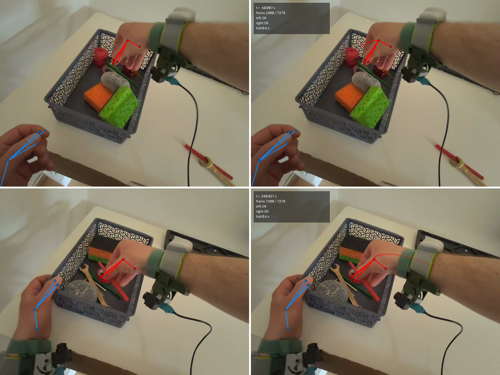

# Наложение: след кистей и HUD (задача 08b)



Слева — кадр 08a (только скелет, `--no-trail --no-hud`), справа — 08b (скелет + след + HUD).
Верхний ряд — t = 60.0 с, нижний — t = 240.0 с: на нижнем кадре видно, откуда пришла правая
кисть, — затухающий след тянется от трекера к корзине.

## Порядок отрисовки

1. **След кистей** — под скелетом, чтобы точки и линии читались поверх шлейфа.
2. **Скелет** — 5 точек и 4 линии на руку (08a, цвета: левая голубая, правая красная).
3. **HUD** — поверх всего: подписи должны быть читаемыми на любом фоне.

## След (trail)

- **Что это.** Мировой путь **ладони** за последние `TRAIL_SECONDS = 0.6` с, нарисованный
  затухающей ломаной: у текущего момента (`TRAIL_ALPHA_NEW = 0.80`) линия ярче, у старого конца
  окна (`TRAIL_ALPHA_OLD = 0.12`) — почти прозрачная.
- **Выборка по времени.** Шаг `TRAIL_STEP_S = 1/30` с (плотность кадров записи) → 19 выборок на
  окно. Окно и шаг заданы в секундах, а не в номерах кадров: след одинаков при любом fps и
  `--start/--end`, а не «короткий» на рендере в 15 fps и «длинный» в 60.
- **Матрица текущего кадра.** Точки прошлых моментов проецируются матрицей мира→камера **того
  кадра, который рисуется**. Иначе шлейф отставал бы от собственной камеры при повороте головы.
- **Прозрачность без OpenCV-alpha.** `cv2.line` не умеет alpha, поэтому отрезок рисуется в
  маску размером со свой ограничивающий прямоугольник, и пиксели кадра смешиваются с цветом
  только там, где маска ненулевая (иначе на кадр лёг бы полупрозрачный **тёмный прямоугольник**
  вокруг линии). Антиалиасинг сохраняется.
- **Разрывы.** Отрезок рисуется, только если оба его конца видимы. «Нет данных»
  (`isActive = 0`, NaN сустава, точка за камерой) рвёт линию — след не соединяет «до» и
  «после» перехода. Выборки вне диапазона трекинга отбрасываются: на старте записи следа ещё
  нет, на хвосте он кончается последним сэмплом, а не залипает на замороженной позе.
  Поэтому правая рука, невалидная в первые ~0.8 с, получает след только когда её позы
  становятся валидными (первый видимый след — кадр 31, t ≈ 1.03 с; ср. первые валидные
  сэмплы на 0.83 с).

## HUD

Полупрозрачная панель в левом верхнем углу, `HUD_*` в `src/overlay_video.py`; для кадра
1080×810 это прямоугольник `(12, 12, 342, 148)`, дальше размеры масштабируются шириной кадра.
Строки:

```
t =   60.007 s
frame 1800 / 7278
left: OK
right: OK
trail 0.6 s
```

- `left/right` — флаг `isActive` руки на кадре; при `isActive = 0` пишется `NO DATA` цветом
  предупреждения (оранжево-жёлтый) — например, правая рука в первые ~0.8 с записи и в
  последнюю секунду.
- Последняя строка — окно следа (`trail off` при `--no-trail`), а после конца трекинга к ней
  добавляется `| pose frozen` (поза последнего сэмпла, 04a).
- **Почему латиница.** `cv2.putText` с Hershey-шрифтами не рисует кириллицу; чтобы подписи
  были читаемыми, они английские, а русские пояснения живут в доках.
- **Почему панель не двигается.** Размер и положение фиксированы, поэтому проверяемо: на
  5 размеченных кадрах эталона 07a панель не пересекается ни с одной рамкой кисти и не
  накрывает ни одного сустава, попавшего в кадр (тесты `test_hud_does_not_cover_labeled_hands`,
  `test_no_projected_joint_inside_hud`). Текст проверяется на вписывание в панель до
  отрисовки.

## Числа прогона (29.10, эта машина)

- Полный клип: 7279 кадров 1080×810 за **64.9 с** (112 кадр/с), H.264 (`avc1`), **94.6 МиБ**,
  длительность **242.66 с** — совпадает с исходным видео; за прогон нарисовано **202 108**
  отрезков следа и **72 535** видимых суставов; 3 кадра в хвосте — без сэмплов (поза заморожена).
- Оверхед следа и HUD мал: фрагмент 300 кадров рендерится 103 кадр/с со следом+HUD против
  108 кадр/с без них (≈4 %).
- След правой руки виден с кадра 31 по кадр 7262 (кисть входит в кадр / трекинг кончается),
  левой — с кадра 11 по 7231 (левую кисть часто обрезает край кадра).

## Как воспроизвести

```bash
# кадры «до» (как в 08a) и «после» (08b):
python src/overlay_video.py data/CameraRecord_*.mp4 \
    --stills output/debug/overlay_before --frames 1800,7200 --no-trail --no-hud
python src/overlay_video.py data/CameraRecord_*.mp4 \
    --stills output/debug/overlay_08b --frames 1800,7200

# полный клип со следом и HUD:
python src/overlay_video.py data/CameraRecord_*.mp4 --out output/overlay.mp4

# варианты: окно следа и выключение элементов
python src/overlay_video.py data/CameraRecord_*.mp4 --out /tmp/overlay_1s.mp4 --trail-seconds 1.0
python src/overlay_video.py data/CameraRecord_*.mp4 --out /tmp/overlay_plain.mp4 --no-trail --no-hud
```

В репозиторий коммитится только собранная сетка `images/overlay_before_after.png` (2×2 из
`frame_01800.png`/`frame_07200.png`, уменьшенных до 540×405); PNG в `output/` — регенерируемый
артефакт (`output/` в `.gitignore`).
